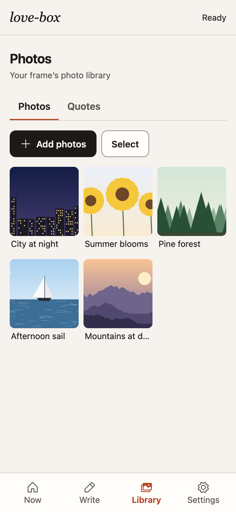
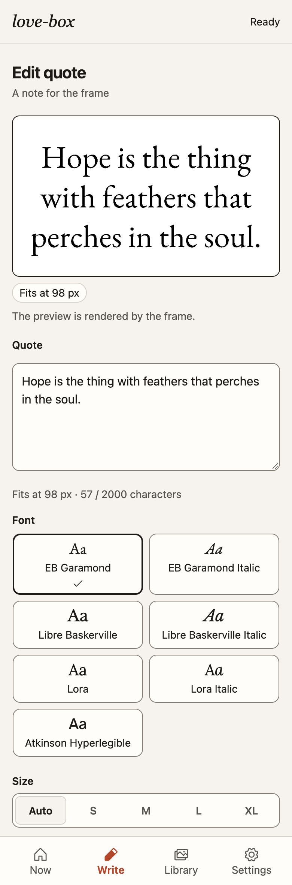
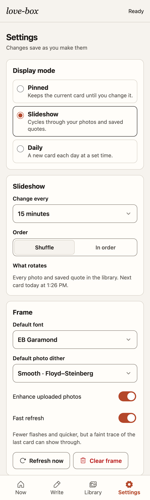

# love-box

An e-paper picture frame you control from your phone. Send a note, pick a photo, or let it
run a slideshow of your favourites. Built as a gift for leaving messages for someone you
love. It runs on a Raspberry Pi Zero W on your home network.

## The frame

### Displaying a picture

### Displaying text

### The wiring


### The case for the Pi and the Waveshare HAT


## The web interface

A small web app served by the frame itself, at `http://lovebox.local`. It works on a phone
or a laptop, in light and dark themes; save it to the home screen and it opens like an app.
The screenshots use demo content.


<table>
<tr>
<th>Now</th><th>Now, dark theme</th><th>Library</th>
</tr>
<tr>
<td></td>
<td></td>
<td></td>
</tr>
<tr>
<th>Write</th><th>Photo crop</th><th>Settings</th>
</tr>
<tr>
<td></td>
<td></td>
<td></td>
</tr>
</table>

## What it does

- **Messages and quotes**: type a message in four sizes, or a quote that auto-fits the
  frame in one of several open-licence fonts. Save quotes to the library.
- **Photos**: upload from your phone; each is cropped to the panel (drag and resize the
  crop box to choose what shows) and dithered to black and white.
- **Preview equals panel**: every preview is the exact 800x480 frame the panel will show,
  rendered by the frame's own code.
- **Modes**: *Pinned* keeps one card up. *Slideshow* shows a new photo or saved quote every
  interval (15 seconds to 24 hours), shuffled or in order. *Daily* shows a new one each day
  at a set time. Everything in the library takes part, and everything comes round before
  anything repeats. Sending something by hand pins it, pausing the slideshow; Start
  slideshow on the Now screen resumes it.
- **Refresh**: every change is one full refresh. *Fast refresh* (the default) uses
  Waveshare's shorter waveform: fewer flashes and about 4.5 s from wake to sleep. Turn it
  off in Settings for the standard refresh (more flashes, cleanest image).
- **Easy to run**: one-command deploy from a laptop, a systemd service, a status page,
  backups, and everything testable on a laptop without the hardware.

## Hardware

| Part | Notes |
|---|---|
| [Waveshare 7.5" e-Paper HAT](https://www.waveshare.com/7.5inch-e-paper-hat.htm), V2 panel | 800x480, 1-bit black and white, SPI. Every update is a full refresh with a few flashes; no partial refresh. Waveshare advises ≥180 s between refreshes for panel life |
| Raspberry Pi Zero W | The original, single-core ARMv6, 512 MB. A Zero 2 W also fits the same case and HAT |
| 5 V / 2.5 A micro-USB power supply | Into the port marked PWR IN. A thin or long cable causes brownouts |
| microSD card, 8 GB or more | Buy one that ships with an SD adapter for flashing |
| 7"x5.5" picture frame and a 3D-printed case | Case holds the Pi with the HAT on its header |

Wiring is the HAT on the Pi's 40-pin header. Pins used (BCM numbering): RST 17, DC 25,
CS 8 (SPI0 CE0), BUSY 24; SPI0 at 4 MHz. SPI is enabled at first boot by the setup in
[docs/PI-SETUP.md](docs/PI-SETUP.md).

## Software

| Layer | Choice |
|---|---|
| OS | Raspberry Pi OS Lite, 32-bit (Trixie), headless, configured with cloud-init at first boot |
| Service | One Rust binary, `lovebox`, run by systemd as an unprivileged user |
| Web | `axum` + `tokio`, JSON API, embedded static UI (Vite + React + TypeScript) |
| Panel | Our own V2 driver (Waveshare's command sequences, normal or fast refresh) over `rppal` SPI/GPIO, behind a `Panel` trait with a PNG implementation for development |
| Rendering | `image` crate, Floyd–Steinberg dithering to 1-bit, text layout with an open-licence serif |
| State | One JSON state document plus a photo directory under `/var/lib/lovebox`; no database |
| Network | mDNS (`lovebox.local`) via avahi; LAN only |
| Build | Cross-compiled on a laptop with `cargo-zigbuild` to `arm-unknown-linux-gnueabihf`; `make build-pi` |

## Repository

```
lovebox/     Rust crate: the service (API, renderer, panel driver, scheduler)
web/         React web app; web/dist is built output, committed and embedded in the binary
deploy/      systemd unit, provision/deploy/backup scripts, ARMv6 check
docs/        API.md, UI-DESIGN.md, PI-SETUP.md (blank card to running Pi),
             RESEARCH.md (panel and toolchain notes), decisions/, screenshots/
Makefile     make test | lint | run | build-pi | check-pi | deploy | rollback | backup
AGENTS.md    rules and context for AI coding agents
HISTORY.md   what has changed, and when
```

## Developer quick-start

You need [rustup](https://rustup.rs) (the toolchain is pinned by `rust-toolchain.toml`) and
Node with npm. Deploying also needs `cargo-zigbuild` and a `zig` it can find; see
[deploy/README.md](deploy/README.md).

```bash
make run
```

That builds the web app and starts the service at `http://localhost:8080` with a PNG panel
instead of the e-paper: each frame is written to `lovebox/data/panel/frame.png`, and state
and photos live in `lovebox/data/` (gitignored). Delete that folder to start fresh.

- **Changing the web app**: edit `web/src/main.tsx` and `web/src/style.css`, then rerun
  `make run`. The built assets in `web/dist` are embedded in the binary, so commit them
  with the source.
- **Before committing**: `make lint` (rebuilds the web app, `cargo fmt --check`, clippy)
  and `make test`. Rendering changes are checked against golden PNGs in
  `lovebox/tests/golden/`; regenerate them with `UPDATE_GOLDENS=1 make test`.
- **On the Pi**: `make deploy` builds for ARMv6, ships the binary, restarts the service and
  fails loudly if it does not come up; `make rollback` restores the previous binary;
  `make backup` copies the frame's data to the laptop. Logs:
  `ssh pi@lovebox.local journalctl -u lovebox -f`. The status page is under Settings.
- **New Pi or new card**: [docs/PI-SETUP.md](docs/PI-SETUP.md).

The HTTP API is in [docs/API.md](docs/API.md) and the UI's design rules in
[docs/UI-DESIGN.md](docs/UI-DESIGN.md). [AGENTS.md](AGENTS.md) holds the rules for working
here (with or without an AI agent): rendering rules to preserve, the hardware boundary,
and no secrets in the repo.

## History

This is a rewrite of a 2022 Python/Firebase version. [HISTORY.md](HISTORY.md) summarises
what changed and when.
