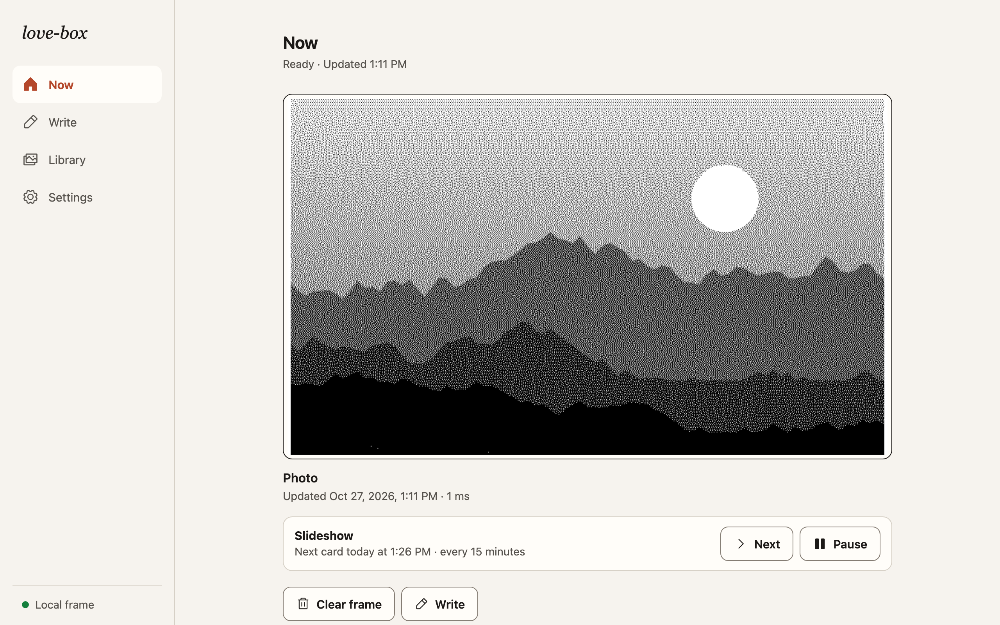
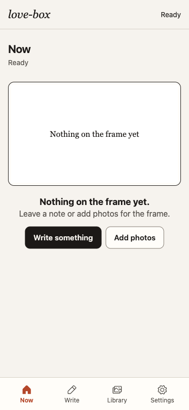
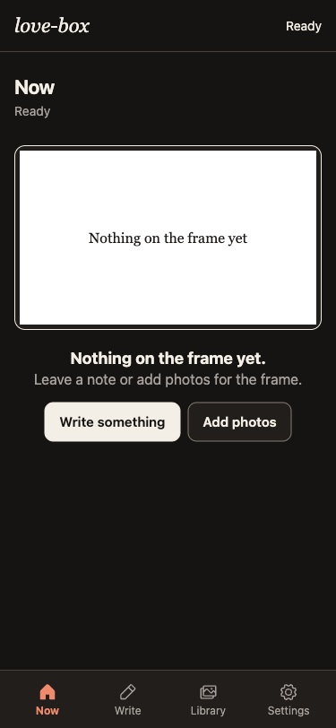
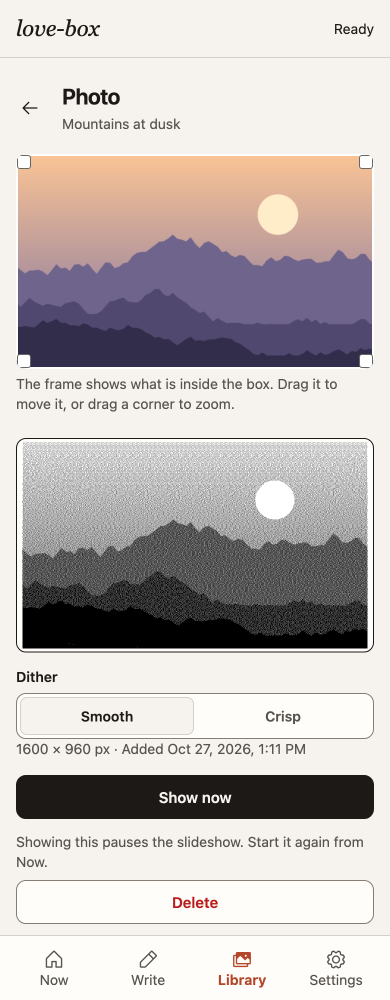

# love-box

An e-paper picture frame you control from your phone. Send a note, pick a photo, or let it
rotate through your favourites; the panel updates in seconds. Built as a gift for leaving
messages for someone you love. Runs entirely on a Raspberry Pi Zero W on your home network,
with no cloud account.

## The frame

### Displaying a picture

### Displaying text

### The wiring


### The case for the Pi and the Waveshare HAT


## The web interface

The local web app works on a phone or desktop, in light and dark themes. These captures show the current interface running against the embedded service.



| Phone · light theme | Phone · dark theme |
|---|---|
|  |  |



## What it does

- **Web page on your LAN** at `http://lovebox.local`. Anyone on the Wi-Fi can send a message
  or choose a photo from a phone. No app, no account, no internet needed.
- **Messages and quotes**: type a message in four sizes, or a quote that auto-fits the
  frame in one of several open-licence fonts. Save quotes to a library.
- **Photos**: upload from your phone; each one is cropped to the panel (drag and resize
  the crop box to choose what shows) and dithered to black and white.
- **Modes**: pin one card until you change it; Slideshow: a new photo or saved quote
  every interval you choose (15 seconds to 24 hours), shuffled or in order; or Daily: a
  new one each day at a time you choose. Both cycle through everything before repeating.
  Every change is a full refresh: about 4 seconds, with a visible black-and-white flash.
- **Planned** ([docs/PLAN.md](docs/PLAN.md)): quiet hours overnight, photos
  picked from Google Photos (through Google's Picker API), and optional AI-written daily
  notes and captions through the Claude API.
- **Preview equals panel**: the page shows the exact 800x480 frame the e-paper will show.
- **Boring to operate**: one-command deploy from your laptop, a systemd service, a health
  page, backups, and everything testable on a laptop without the hardware.

## Hardware

| Part | Notes |
|---|---|
| [Waveshare 7.5" e-Paper HAT](https://www.waveshare.com/7.5inch-e-paper-hat.htm), V2 panel | 800x480, 1-bit black and white, SPI. Every update is a ~4 s full refresh with a flash; no partial refresh in the Rust driver. Waveshare advises ≥180 s between refreshes for panel life |
| Raspberry Pi Zero W | The original, single-core ARMv6, 512 MB. A Zero 2 W also fits the same case and HAT |
| 5 V / 2.5 A micro-USB power supply | Into the port marked PWR IN. A thin or long cable causes brownouts |
| microSD card, 8 GB or more | Buy one that ships with an SD adapter for flashing |
| 7"x5.5" picture frame and a 3D-printed case | Case holds the Pi with the HAT on its header |

Wiring is the HAT on the Pi's 40-pin header. Pins used (BCM numbering): RST 17, DC 25,
CS 8 (SPI0 CE0), BUSY 24; SPI0 at 4 MHz. SPI is enabled at first boot by the setup in
[docs/PI-SETUP.md](docs/PI-SETUP.md).

## Software

| Layer | Choice |
|---|---|
| OS | Raspberry Pi OS Lite, 32-bit (Trixie), headless, configured with cloud-init at first boot |
| Service | One Rust binary, `lovebox`, run by systemd as an unprivileged user |
| Web | `axum` + `tokio`, JSON API, embedded static UI (Vite + React + TypeScript) |
| Panel | `epd-waveshare` (`epd7in5_v2`) over `rppal` SPI/GPIO, behind a `Panel` trait with a PNG implementation for development |
| Rendering | `image` crate, Floyd–Steinberg dithering to 1-bit, text layout with an open-licence serif |
| State | One JSON state document plus a photo directory under `/var/lib/lovebox`; no database |
| Network | mDNS (`lovebox.local`) via avahi; LAN only |
| Build | Cross-compiled on a laptop with `cargo-zigbuild` to `arm-unknown-linux-gnueabihf`; `make build-pi` |

## Repository

```
lovebox/     Rust crate: the service
deploy/      systemd unit, provision/deploy/backup scripts, ARMv6 check
docs/        PLAN.md (design and milestones), PI-SETUP.md (blank card to running Pi),
             RESEARCH.md (sourced findings), decisions/ (ADRs)
web/         React web app, built into the binary
Makefile     make test | lint | run | build-pi | check-pi | deploy | rollback | backup
AGENTS.md    entry point for AI coding agents
HISTORY.md   what has changed, and when
```

## Getting started

1. Flash a card and bring the Pi onto your Wi-Fi: [docs/PI-SETUP.md](docs/PI-SETUP.md).
2. On your laptop: install [rustup](https://rustup.rs), then `cargo install cargo-zigbuild`
   and a `zig` it can find (see [deploy/README.md](deploy/README.md)).
3. `make test`, then `make deploy HOST=pi@lovebox.local`.

### With an AI coding agent

[AGENTS.md](AGENTS.md) tells an agent what the project is, the rendering rules to preserve,
the commands that exist, and the rules for working here. Open the repo in Claude Code or any
agent that reads `AGENTS.md` and point it at the next unfinished milestone in
`docs/PLAN.md`. Secrets (Wi-Fi, OAuth client, API keys) never go in the repo.

## History

This is a rewrite of a 2022 Python/Firebase version. [HISTORY.md](HISTORY.md) summarises
what changed and when.
